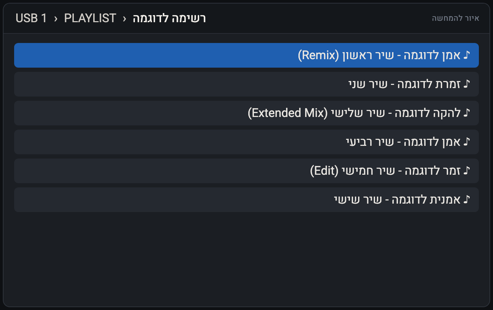
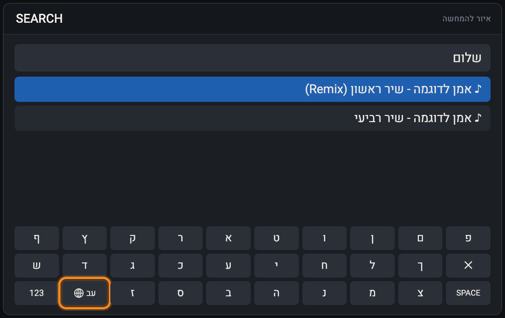

# Hebrew RTL: Hebrew for the XDJ-AZ

An [AZ-MODS](https://github.com/Kyle-Hosman/xdj-az-mods) community mod. It gives the Pioneer DJ / AlphaTheta **XDJ-AZ** three things:

- **Hebrew letters.** Track, artist, album, playlist and folder names show real Hebrew letters instead of empty boxes.
- **Right-to-left order.**
  - Hebrew names read right to left.
  - Latin words, numbers and brackets inside them keep their correct order.
  - Long names are cut on the correct side.
  - The selected row scrolls the Hebrew way.
- **A Hebrew search keyboard.** A globe key on the search screen switches between English and Hebrew (Israeli layout).





*Illustrations with example names, not screenshots of the deck.*

The mod changes no files on the deck. It runs only while a USB with the mod is in the deck. Take the USB out, or switch the mod off, and the deck is exactly as before.

> [!CAUTION]
> This is an unofficial mod. It is not made, checked or supported by Pioneer DJ / AlphaTheta, or by the AZ-MODS project. It needs the AZ-MODS modified firmware. **Use at your own risk.** Try it at home before you use it at a gig.

---

## Requirements

| | |
|---|---|
| Deck | XDJ-AZ |
| Firmware | **AZ-MODS 2.01**, built from the stock XDJ-AZ firmware **2.00**. Firmware tag `ep147-9e9454e357389ece`. |
| USB stick | FAT32 or exFAT, the stick you play from |

On any other firmware, the mod does not load. It shows **"Not made for this firmware"** and the deck works normally.

---

## Part 1: install AZ-MODS (the patched firmware), once

AZ-MODS is a separate project by Kyle Hosman. It patches the XDJ-AZ firmware with a mod loader. Follow its official instructions: **<https://github.com/Kyle-Hosman/xdj-az-mods#install>**. In short:

1. **Download the stock firmware.**
   - Get **`XDJAZv200.UPD`** (XDJ-AZ firmware 2.00) from the official Pioneer DJ / AlphaTheta support site.
   - Format a USB stick as **FAT32** for the flash.
2. **Get the AZ-MODS desktop app** (macOS or Windows) from the [AZ-MODS releases page](https://github.com/Kyle-Hosman/xdj-az-mods/releases).
3. **Build and write the patched firmware.**
   - In the app's **Install** tab, drop in `XDJAZv200.UPD` and select the USB stick.
   - Click **Build & write to USB**. This builds AZ-MODS firmware **2.01**.
4. **Flash the deck.**
   - Power the deck off and put the USB in **USB 1**.
   - Hold **deck 2's BEAT SYNC + MASTER** while you power on, then run the update.
   - **Do not cut the power during the flash.** Losing power mid-flash is the one real risk.
5. **Set up your music USB.** In the desktop app, select your music USB, tick the AZ-MODS features you want and click **Install to USB**. This creates the `MODS` folder on the stick.
6. **First boot.** Boot the deck with that USB. The first boot after installing mods shows a **black screen** for a few seconds while the mods load. This is normal.

You flash only once. After that, mods and updates live in the `MODS` folder on your USB. To remove AZ-MODS completely and go back to stock, follow the [AZ-MODS uninstall steps](https://github.com/Kyle-Hosman/xdj-az-mods#uninstall).

---

## Part 2: install the Hebrew mod

Pick **one** of the three ways below.

### A. From the deck (easiest, needs the deck online)

1. On the deck, press **SOURCE** and open the **MOD MENU** row.
2. Go to **Community Mods → Repositories → Add** and enter:
   ```
   yakirkremer/hebrew-rtl
   ```
3. Go to **Community Mods → Browse**, open **Hebrew RTL** and press **Install**, then **Reload now**.

Installing from the deck also approves the mod, so there is nothing else to confirm.

### B. With the AZ-MODS desktop app

1. Plug in your music USB.
2. In the app's **Community Mods** tab, add the repository `yakirkremer/hebrew-rtl` and install **Hebrew RTL** to the USB.
3. Boot the deck with the USB.
4. In **Mod Menu → Community Mods → Installed**, open **Hebrew RTL** (it says **New mod found: allow?**). Press **Allow**, then **Reload now**.

### C. By hand

1. Download `hebrew-rtl-<version>.azmod` from the [latest release](https://github.com/yakirkremer/hebrew-rtl/releases/latest). It is a ZIP file.
2. Unzip it into `MODS/community-mods/hebrew-rtl/` on your music USB, so the folder looks like this:
   ```
   MODS/
   ├── azmods.cfg
   └── community-mods/
       └── hebrew-rtl/        ← the name must be exactly "hebrew-rtl"
           ├── azmod.json
           ├── hebrew-rtl.so
           ├── icon.png
           └── LICENSE
   ```
   On macOS, run this in Terminal. Replace `MYUSB` with your stick's name and `0.9.1` with the version you downloaded:
   ```bash
   mkdir -p "/Volumes/MYUSB/MODS/community-mods/hebrew-rtl" && unzip -o ~/Downloads/hebrew-rtl-0.9.1.azmod -d "/Volumes/MYUSB/MODS/community-mods/hebrew-rtl"
   ```
   In Finder: rename the `.azmod` to `.zip`, double-click it, rename the folder it makes to `hebrew-rtl`, and move that folder into `MODS/community-mods/`.
3. Open `MODS/azmods.cfg` in a text editor and add this line at the end, once:
   ```
   community-mods.hebrew-rtl = on
   ```
4. Eject the USB properly. Boot the deck with it.
5. In **Mod Menu → Community Mods → Installed**, open **Hebrew RTL** (it says **New mod found: allow?**). Press **Allow**, then **Reload now**.

### Check that it works

**Mod Menu → Community Mods → Installed** should show **Hebrew RTL: Loaded**. Browse a playlist with Hebrew names: you should see Hebrew letters, right to left.

The deck remembers the approval, so the mod loads every time you boot with this USB. A **new version** asks **Allow** once more (method B or C). That is AZ-MODS' safety check that a USB alone cannot run new code.

---

## Using it

### Hebrew names

Nothing to do. Hebrew shows in the browser, the deck strips, the 4-deck view, playlists and search results.

### Hebrew search

1. Open **SEARCH**. A new key with a globe and **EN** sits between **123** and **z**.
2. Tap it. The keys turn Hebrew and the key shows **עב**.
3. Type, and the results update as usual.
4. Tap the globe again to return to English.

Notes:
- The deck has no `;` or `.` key, so on the Hebrew layout the **q** key gives **ף** and the **w** key gives **ץ**.
- The keyboard remembers English or Hebrew across reboots.
- With no source loaded, the Hebrew keys are greyed out, like the original keyboard.

---

## Turning it off / removing it

- **For a gig without it:** Mod Menu → Community Mods → Installed → Hebrew RTL → off. Or boot with a USB that does not have the mod.
- **Remove:** delete `MODS/community-mods/hebrew-rtl` from the USB and its line in `MODS/azmods.cfg`, then power-cycle the deck.

## If something goes wrong

| You see | Meaning / what to do |
|---|---|
| The mod is not listed under Installed | The folder name or place is wrong, or the `azmods.cfg` line is missing (method C). |
| **Not made for this firmware** | The deck is not on AZ-MODS 2.01 / firmware 2.00. The mod stays off and the deck is unaffected. |
| **Suspended: it crashed the deck** | AZ-MODS caught a crash and switched the mod off by itself. Please [open an issue](https://github.com/yakirkremer/hebrew-rtl/issues) saying what you were doing. **Try again → Reload now** re-enables the mod. |
| Boxes instead of Hebrew letters | The mod is not loaded. Check its status under Installed. |

## Known limitations

- **The search box's cursor.** With Hebrew in the search box, the cursor is drawn on the right of the text instead of the left. Typing and deleting work normally.
- **Arabic.** Arabic letters show, but are not joined.
- **Wrapped text.** Text that wraps onto several lines may be in an imperfect order.
- **One firmware only.** The mod is made for one firmware build. After a firmware update it stays off until a new version supports that firmware.
- **Testing so far.** It was tested in an XDJ-AZ emulator with a real 2,000-track library, including reboots and stress tests. Real-deck reports are welcome.

---

## Building from source

The mod is built with the [AZ-MODS SDK](https://github.com/Kyle-Hosman/az-mods-sdk) (Docker needed):

```bash
<sdk>/tools/azmod-pack build .      # builds out/hebrew-rtl.so in the SDK container
<sdk>/tools/azmod-pack package .    # makes dist/hebrew-rtl-<version>.azmod
```

Unit tests run on your computer with clang:

```bash
clang -std=gnu11 -fsanitize=address,undefined -I . bidi.c tests/test_bidi.c -o out/test_bidi && out/test_bidi
clang -std=gnu11 -DHEB_GLYPHS_TEST -fsanitize=address,undefined -I . glyphs.c bidi.c tests/test_glyphs.c -lm -o out/test_glyphs && out/test_glyphs
clang -std=gnu11 -fsanitize=address,undefined -I . -I <sdk>/include tests/test_editor.c bidi.c glyphs.c -lm -o out/test_editor && out/test_editor
```

| File | What |
|---|---|
| `hebrew-rtl.c` | the hooks: right-to-left lines, cutting, the scrolling row, the search field's word order, the search keyboard |
| `bidi.c` | a small Unicode bidirectional algorithm (UAX #9 subset) |
| `glyphs.c` | adds the Hebrew letters to the deck's fonts in memory, from the built-in font |
| `heb_font.h` | Noto Sans Hebrew SemiBold, Hebrew letters only |
| `kbd_icons.h` | the keyboard's key images, made by `tools/make_kbd_icons.py` |

A release is made by pushing a tag `hebrew-rtl-<version>`. GitHub Actions builds, packages and publishes it, and updates `azmods-repo.json`.

## Credits and licence

- Code: **GPL-3.0-only** (see `LICENSE`).
- Hebrew font: [Noto Sans Hebrew](https://fonts.google.com/noto/specimen/Noto+Sans+Hebrew), SIL Open Font License 1.1 (see `NotoSansHebrew-OFL.txt`).
- Font rasteriser: [stb_truetype](https://github.com/nothings/stb) (public domain / MIT).
- [AZ-MODS](https://github.com/Kyle-Hosman/xdj-az-mods) and its SDK by Kyle Hosman.

XDJ-AZ, Pioneer DJ and AlphaTheta are trademarks of their owners. This project is not affiliated with them.
